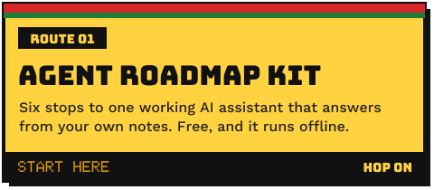
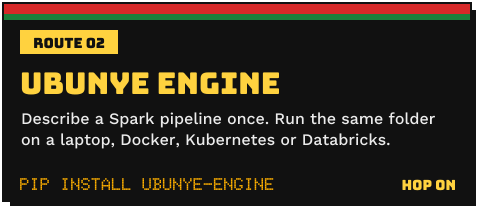
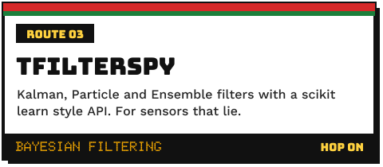
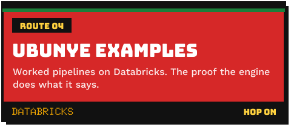
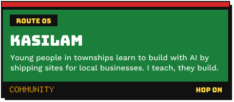
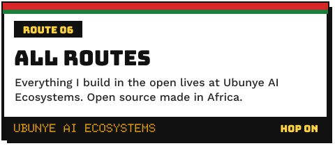
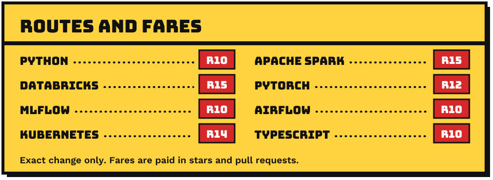

  

  
  
  
  
  

I build machine learning and data systems that run in production, from Soshanguve.
Nine years across insurance, telecommunications, research and higher education.
Everything I build in the open goes through [Ubunye AI Ecosystems](https://github.com/ubunye-ai-ecosystems):
serious open source made *in* Africa, not only used here.

### Hop on here

   

   

   

### Rank board

<!-- RANK-BOARD:START -->
| | |
|---|---|
| **Latest from the blog** | [What the Road Makes Possible](https://www.tmashininisekgoto.com/blog/data-team-what-it-makes-possible) [Stage 5: Trust Your People, Then Let Go](https://www.tmashininisekgoto.com/blog/data-team-trust-and-let-go) [Stage 4: When People Push Back, Show Them](https://www.tmashininisekgoto.com/blog/data-team-when-they-push-back) |
| **Ubunye Engine** | [v0.8.0 on PyPI](https://pypi.org/project/ubunye-engine/), 600 downloads in the last month |
| **Last public trip** | [LeparaLaMapara/LeparaLaMapara](https://github.com/LeparaLaMapara/LeparaLaMapara) on 2026-11-08 |

The rank marshal updates this board every morning. Last update 2026-11-08.
<!-- RANK-BOARD:END -->

### Passengers picked up

<picture>
  <source media="(prefers-color-scheme: dark)" srcset="assets/taxi-dark.svg">
  
</picture>

<b>Research</b>: floods from space, echo state networks, mines

 

I am preparing doctoral research at Wits on **physics informed self supervised learning for SAR based flood extent mapping**,
aimed at insurance risk in data scarce regions. It is at proposal stage and not yet registered.

**[Echo State Networks for image segmentation](https://github.com/LeparaLaMapara/ESNIterativeSegmentation)** is the code behind my MSc at Wits:
level set segmentation learned as a problem in space and time.
[The research, line by line](https://www.tmashininisekgoto.com/research/echo-state-networks-level-set-segmentation).

**[Ubuntu CFD](https://github.com/LeparaLaMapara/ubuntu-cfd-AI)** is an agent that discovers its cost function instead of optimising a fixed one.
It argues that fixed extractive objectives are mathematically unstable over long horizons, not only ethically wrong.

Published work covers hearing loss estimation in mine workers, noise policy for mining and long range seasonal temperature forecasting.
[Every paper, with BibTeX](https://www.tmashininisekgoto.com/publications).

<b>Writing</b>: AI engineering, MLOps, Spark, building in South Africa

 

**The Practical Roadmap to Building With AI Agents** is a six part series where every post ends with something you can run.
[Start the series](https://www.tmashininisekgoto.com/blog/how-i-used-ai-to-build-this-site).

[Blog](https://www.tmashininisekgoto.com/blog) · [dev.to](https://dev.to/thabanglukheth0) · [RSS](https://www.tmashininisekgoto.com/feed.xml)

  

Sharp sharp. Shout <b>"short left"</b> and I'll stop at your issue.

